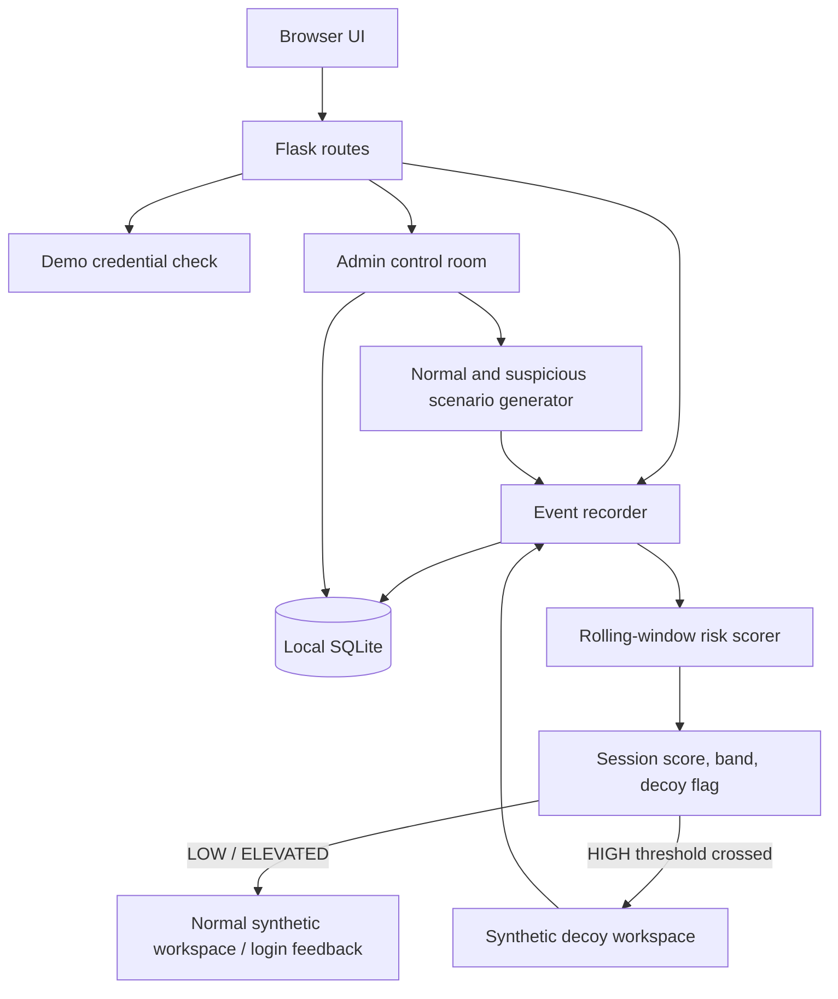

# HoneyShield architecture

## Request flow

1. A browser receives a random session identifier. No database row is required until the first recorded event.
2. A login submission is validated on the server. Submitted password values are checked against the demo user's stored password hash but never added to event details or logs.
3. Failed-login events include a UTC timestamp, an interval, and a per-session HMAC fingerprint of the attempted username. The raw attempted username is not stored.
4. After each event, the scorer examines the session's recent failed-login events, sums applicable configured heuristic weights, clamps the score to 0–100, and updates the risk band/reasons.
5. If the score reaches the configured threshold, the server marks the session as decoy-active and adds a `decoy_activated` event. Future login submissions from that session are routed to the decoy.
6. Decoy actions are allow-listed and create new events. The admin dashboard reads its cards, session rows, event stream, and evidence from SQLite.
7. Simulator endpoints generate synthetic timestamps/principals and pass events through the same `record_event` / `calculate_risk` path; they do not send traffic outside the local app.

## SQLite tables

- `users`: username and password hash for the single public demo account.
- `sessions`: session key, authentication state, last score and band, whether the decoy is active, scenario label, and human-readable risk reasons.
- `events`: event timestamp/type, optional interval, optional username fingerprint, and a small JSON object containing only allow-listed non-sensitive metadata.

## Important constraints

The development secret key is not suitable for deployment. This demo intentionally does not implement production authentication, CSRF protection, administrator authorization, a production WSGI server, or a validated ML detector. Risk bands are behavioural heuristics, not proof of identity or malicious intent.
